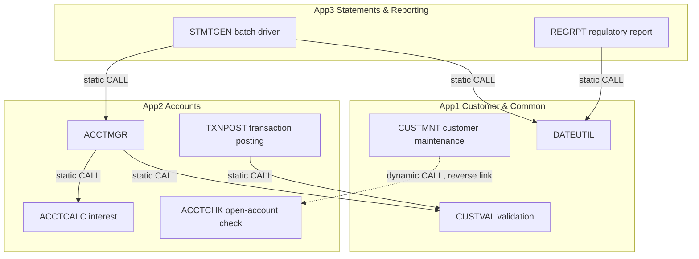

# Cross-Application Dependency Demo: Design (draft)

Status: draft. Agreed in design discussion. Not yet implemented in full.

## 1. Purpose

Three COBOL applications for a retail banking portfolio. They are a test bed for
**build** (IBM DBB / zAppBuild) and, later, **deployment**. The business logic is
kept simple. The cross-application dependencies are the point.

| Repo | Application | Role |
|---|---|---|
| `MainframeCrossApp1` | Customer & Common | Base layer: customer master, validation, shared utilities |
| `MainframeCrossApp2` | Accounts | Account management, interest, transaction posting |
| `MainframeCrossApp3` | Statements & Reporting | Statement generation, regulatory report |

## 2. Dependency types demonstrated

1. **Shared copybooks** across repos (build time).
2. **Static CALL** across apps (link-edit time): the callee is in the caller's load module.
3. **Dynamic CALL** across apps (run time): the callee is loaded from STEPLIB.
4. **Shared VSAM data** (KSDS masters and a transaction file).
5. **Batch job ordering** (JCL).

DB2 is out of scope.

## 3. Boundaries and ownership

| App | Copybooks owned | Data owned | Programs |
|---|---|---|---|
| App1 | `CUSTREC` (also the VSAM record), `RETCODES`, `CUSTVLNK`, `DATELNK`, `CLOSELNK` | Customer master KSDS (`CUSTMAST`) | `CUSTMNT`, `CUSTVAL`, `DATEUTIL` |
| App2 | `ACCTREC`, `TXNREC`, `ACCTLNK`, `ACCTMLNK` (`ACCTMGR-RESULT` block only) | Account master KSDS (`ACCTMAST`, alternate key `ACCT-CUST-ID`), transaction file | `ACCTMGR` (three-parameter USING), `ACCTCALC`, `TXNPOST`, `ACCTCHK` |
| App3 | `STMTLINE`, `RPTLINE` | Statement and report output (sequential) | `STMTGEN`, `REGRPT` |

Correction to the earlier draft table: the parameter block for the reverse
call (`CLOSELNK`) is **owned by App1**. `ACCTCHK` in App2 copies it. This keeps
the copybook direction one-way.

### Rules

- **Copybooks flow one way only:** App3 → App2 → App1. App1 never copies from App2 or App3. The build-time graph has no cycle.
- **The one reverse link is a dynamic CALL only** (`CUSTMNT` → `ACCTCHK`, `CALL identifier`). The parameter block is App1's `CLOSELNK`, so there is no App1 → App2 copybook dependency.
- **Cross-app data access is read-only.** Only the owning app writes its files. Other apps read through the owner's record copybook.

## 4. Shared interfaces

- No versioning and no reserved filler. Shared copybooks change in place and consumers must be rebuilt.
- This is the common real-world pattern and is the best fit for showing build impact.

## 5. Build design

- Tooling: IBM DBB with zAppBuild.
- One `application-conf` per repo. One shared zAppBuild checkout.
- All three repos sit side by side in one build workspace (`--workspace`), each built with its own `--application`.
- Build order: App1, then App2, then App3.
- Dependency data is shared through DBB's metadata store, so impact analysis can see across apps.
- zAppBuild has a `--reportExternalImpacts` option that reports impacted files in other applications' DBB collections (confirmed in the zAppBuild `BUILD.md` option list).

## 6. Deployment design

Deferred until the builds work.

## 7. Open questions

1. **Downstream build trigger.** `--reportExternalImpacts` reports impacts. It does not build them. Options: manual, a driver script that runs the three builds in order with `--impactBuild`, or pipeline-triggered builds. Undecided.
2. **Cross-repo copybook resolution settings.** The zAppBuild property names for putting other repos' copybooks on the search path (for example `copybookPDS`, `impactSearch`) are **unverified**. Check them against a real zAppBuild checkout before writing any `application-conf`.
3. **Test and demo scenarios.** Parked. Candidate scenarios: change a base copybook; change a statically called program; change the dynamically called program; change a leaf program.
4. **Deployment tooling and library layout.** Deferred (see section 6).

## 8. Gap between this design and the existing prototype code

The existing code is a quick prototype written before this design. It should be
reworked to match.

| Item | State |
|---|---|
| App1 programs and copybooks (`CUSTVAL`, `DATEUTIL`, `CUSTMNT`; `CUSTREC`, `RETCODES`, `CUSTVLNK`, `DATELNK`, `CLOSELNK`) | Written, diagnostics clean, not compiled |
| App2 programs and copybooks (`ACCTMGR`, `ACCTCALC`, `TXNPOST`, `ACCTCHK`; `ACCTREC`, `TXNREC`, `ACCTLNK`, `ACCTMLNK`) | Written, diagnostics clean, not compiled |
| App3 programs and copybooks (`STMTGEN`, `REGRPT`; `STMTLINE`, `RPTLINE`) | Written, diagnostics clean, not compiled (`STMTGEN` now reads the VSAM masters) |
| VSAM definitions (IDCAMS) for `CUSTMAST`, `ACCTMAST` | Written (`CUSTDEF`, `ACCTDEF`), never run |
| Test data (`CUSTIN`, `TXNIN`) | Written as in-stream data inside the run jobs, never run |
| Run JCL | Written, never run: `CUSTRUN`, `CUSTCLS` (App1); `TXNRUN` (App2); `STMTRUN`, `RPTRUN` (App3) |
| Compile JCL | Not written (DBB/zAppBuild is expected to build) |
| Batch job order | `CUSTDEF` → `CUSTRUN` → `ACCTDEF` → `TXNRUN` → `CUSTCLS` → `STMTRUN`/`RPTRUN` |
| zAppBuild `application-conf` | Not written (blocked on open question 2) |
